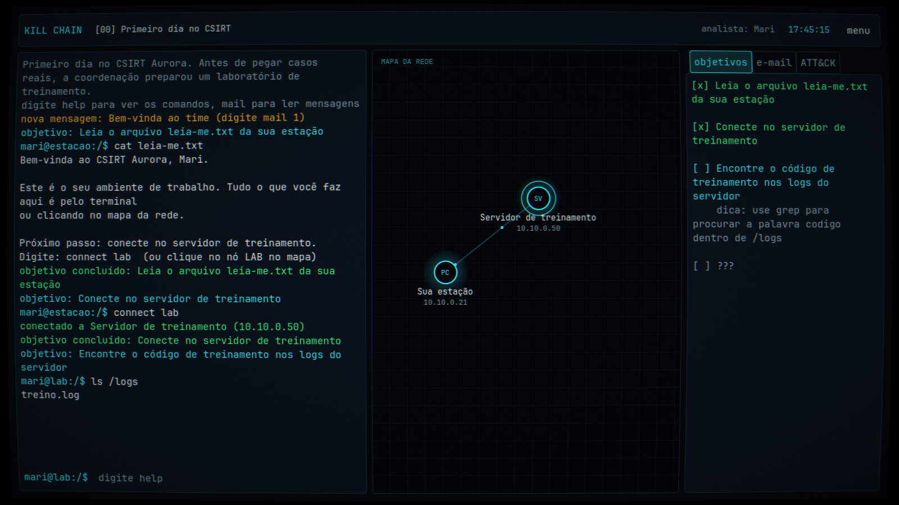
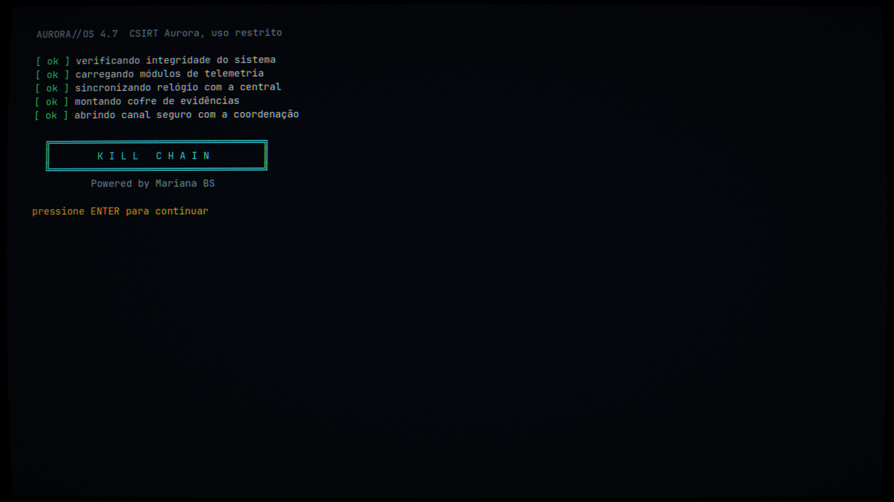
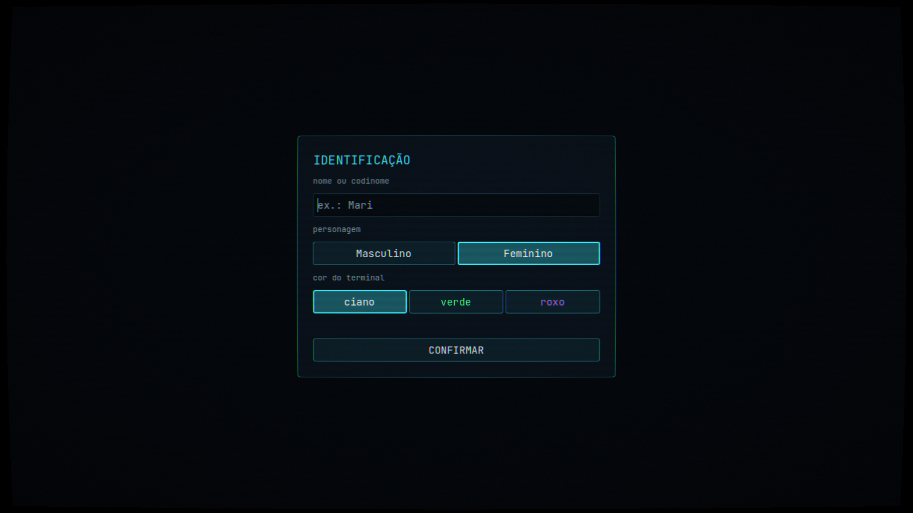
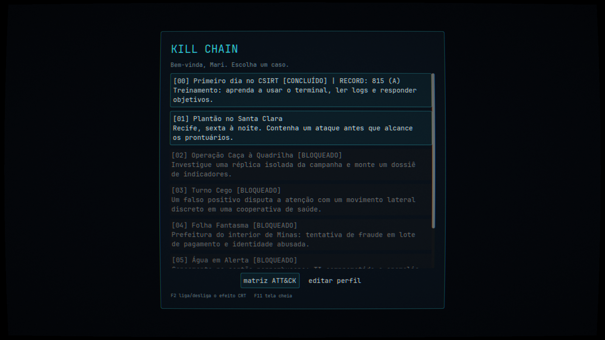
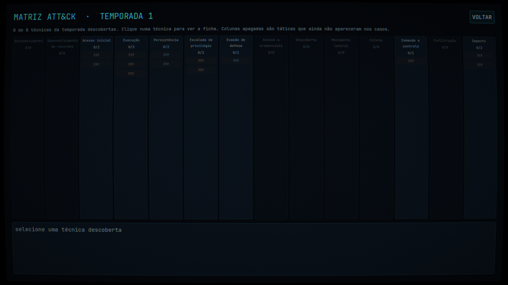
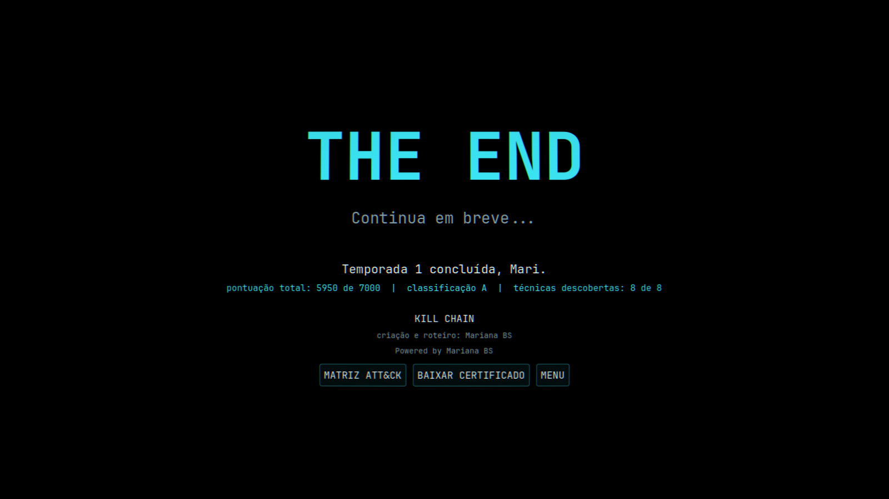

# Kill Chain

Jogo educativo de defesa cibernética, em português, feito em Godot 4. Você é analista de um CSIRT, investiga incidentes pelo terminal e aprende o MITRE ATT&CK caso a caso.

**[Jogar no navegador](https://marianabsctba.github.io/Kill_Chain/)**, sem instalar nada.

Powered by Mariana BS.



| | |
|---|---|
|  |  |
| Abertura | Identificação: nome, personagem e cor do terminal |

## A campanha

Os casos se desbloqueiam em sequência. Cada técnica que você identifica vira uma ficha ATT&CK com o que ela é e como se defender, e cada caso fechado ganha nota de C a S.

| caso | onde | o que esperar |
|---|---|---|
| **[00] Primeiro dia no CSIRT** | laboratório do CSIRT | treinamento guiado: terminal, logs e objetivos |
| **[01] Plantão no Santa Clara** | hospital em Recife | primeiro incidente real, contra o relógio |
| **[02] Operação Caça à Quadrilha** | ambiente de investigação | montar o dossiê de indicadores da campanha |
| **[03] Turno Cego** | cooperativa de saúde | nem todo alerta é o que parece |
| **[04] Folha Fantasma** | prefeitura no interior de Minas | fraude em pagamentos e identidade abusada |
| **[05] Água em Alerta** | saneamento no sertão pernambucano | TI e operação: separar fato de suspeita |
| **[06] A Virada do PIX** | fintech em São Paulo | conter sem derrubar o que precisa continuar de pé |
| **[07] Fechamento** | CSIRT Aurora | ligar os pontos da temporada e fechar o relatório final |

Sem spoilers aqui: as técnicas de cada caso só aparecem quando você as descobre.



### Matriz ATT&CK e fim de temporada

O botão **matriz ATT&CK** no menu mostra as 14 táticas do MITRE ATT&CK e acende as técnicas conforme você fecha os casos. Clicando numa técnica, aparece a ficha com o que ela é e como se defender. As colunas apagadas mostram táticas que a temporada ainda não cobriu.



Ao fechar o último caso, a temporada termina com a tela **THE END**, sua pontuação total e um **certificado em PNG** com seu nome, nota e técnicas descobertas, pronto para compartilhar.



### Comandos

`help`, `ls`, `cd`, `cat`, `grep`, `hosts`, `connect`, `mail`, `objetivos`, `responder`, `decode`, `bloquear`, `isolar`, `desativar`, `fichas`, `arquivo` e `tema`. Digite `help` no jogo para ver o uso de cada um. Ações de contenção erradas custam tempo.

`arquivo` consulta, só para leitura, as evidências de casos já encerrados: `arquivo` lista os casos, `arquivo <caso>` lista os arquivos e `arquivo <caso> <host>:<caminho>` abre um deles. Nas missões, um objetivo `{"tipo": "comando", "comando": "arquivo", "alvo": "<caso>:<host>:<caminho>"}` conclui quando a jogadora abre essa evidência.

Fichas aceitam `"taticas": ["TA0008"]` para indicar a coluna da matriz quando a técnica não estiver no mapa padrão de `scripts/attack_data.gd`.

## Como rodar localmente

1. Instale a [Godot 4.7](https://godotengine.org/download) (versão padrão, não precisa da .NET).
2. Abra a Godot, clique em **Importar** e escolha o arquivo `project.godot` desta pasta.
3. Aperte **F5**.

Atalhos no jogo: **F2** liga e desliga o efeito CRT, **F11** alterna tela cheia, **Tab** completa comandos, **setas** navegam no histórico.

## Estrutura

```
scenes/main.tscn        cena principal
scripts/main.gd         telas: boot, perfil, menu, mesa de trabalho
scripts/game_state.gd   estado global (autoload Game): perfil, missão, arquivos, objetivos
scripts/shell.gd        comandos do terminal
scripts/terminal.gd     terminal com digitação animada, histórico e autocompletar
scripts/net_map.gd      mapa da rede animado
scripts/ui_theme.gd     paleta e tema visual
shaders/crt.gdshader    efeito de monitor CRT
missions/*.json         casos jogáveis
tests/                  teste automático e gerador de prints
docs/prints/            prints usados neste README
```

Para regerar os prints (precisa de janela, não roda em `--headless`):

```
godot --path . --resolution 1600x900 res://tests/screenshots.tscn
```

Eles são salvos na pasta de dados do usuário da Godot; copie para `docs/prints/`.

## Missões

Cada caso é um arquivo JSON em `missions/`, carregado automaticamente no menu. Os textos aceitam:

- `{nome}`: nome do jogador
- `{o|a}`: forma masculina ou feminina, conforme o personagem escolhido (ex.: `Bem-vind{o|a}`)

Tipos de objetivo:

| tipo | conclui quando | campos |
|---|---|---|
| `ler` | o jogador abre um arquivo com `cat` | `host`, `arquivo` |
| `comando` | o jogador roda um comando | `comando`, `alvo` (opcional) |
| `resposta` | o jogador digita `responder <chave> <valor>` | `chave`, `valor` (texto ou lista) |

Todo objetivo pode ter `dica`, `fichas` (fichas ATT&CK desbloqueadas), `revela` (hosts que aparecem no mapa) e `estados` (muda a cor de hosts: `normal`, `alerta`, `comprometido`, `isolado`, `seguro`). E-mails chegam no início (`"quando": "inicio"`) ou ao concluir um objetivo (`"quando": "<id do objetivo>"`).

Veja `missions/00_treinamento.json` como exemplo completo.

## Testes

```
godot --headless --path . res://tests/playthrough.tscn
```

Joga o treinamento inteiro pelo terminal e retorna erro se algo quebrar.

## Progressão e qualidade da investigação

Os casos são sequenciais quando definem `requer` com o ID do caso anterior. Concluir uma missão libera a próxima; os recordes são salvos localmente em `user://progresso.cfg`.

A pontuação vai de 0 a 1.000: 600 pontos por fechar os objetivos, até 200 por fontes distintas consultadas com `cat`, e até 200 por eficiência (tempo restante nas missões cronometradas). Respostas incorretas descontam 35 pontos; contenções indevidas descontam 75, além da penalidade de tempo da missão. Classificações: C, B, A e S.

Missões avançadas podem definir `evidencias` em objetivos do tipo `resposta`: uma lista de `host_id:/caminho` que precisa ser consultada com `cat` antes de aceitar a resposta. Isso exige correlação entre fontes, sem dar a solução na dica. `grep` serve para localizar indícios; abra com `cat` os registros escolhidos para sustentar sua conclusão.

A progressão planejada é gradual: treinamento guiado, incidente com cronômetro, investigação de infraestrutura inteiramente simulada, e caso complexo com falsos positivos e necessidade de confirmação cruzada. Nunca conecte o jogo a infraestrutura real de terceiros.

### Teste completo da campanha

Para validar todos os casos e a progressão sequencial no Godot 4.7:

```bash
godot --headless --path . res://tests/campanha.tscn
```

O teste percorre objetivos, verifica se os hosts já foram revelados, confere caminhos de evidências e fichas, valida as regras de desbloqueio e registra a pontuação. O script de teste usa o perfil de execução local do Godot e pode atualizar `user://progresso.cfg`; execute preferencialmente com um ambiente de teste separado. Além do teste automatizado, faça uma passagem manual para avaliar clareza, tempo e equilíbrio do caso.
